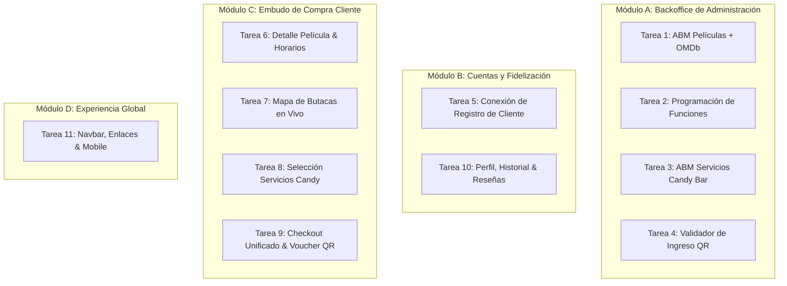

# Tareas Pendientes para Finalizar el Proyecto (Hito 3 & Hito 4)
## Cine Paradiso (Equipo 10) - Backlog de Integración y Vistas

Este documento detalla el estado actual del sistema y la lista exacta de tareas que faltan implementar para completar los requerimientos del enunciado oficial (`docs/Proyecto integrador IDS 2026.pdf`).

> 🎨 **Diseños Oficiales y Mockups de Pantallas (Google Stitch):**  
> Para consultar el diseño visual de cada vista, componentes y versiones mobile, accedé al proyecto:  
> 👉 [Diseños de Pantallas en Google Stitch](https://stitch.withgoogle.com/projects/9068009606258429260)  
> *Al momento de crear o maquetar un template, pasale las fotos o capturas de pantalla de Stitch al asistente para replicar la estructura y los tokens de diseño con exactitud.*

---

## 1. Estado Actual del Sistema (Qué está hecho vs. Qué falta)

| Área / Módulo | Requisito del Enunciado | Estado Backend | Estado Frontend | Estado General |
| :--- | :--- | :--- | :--- | :--- |
| **Infraestructura & BD** | MySQL con DDL, semillas y Docker | ✅ 100% (Puerto 3307) | ✅ Listo | **Completado** |
| **Login Web & Sesión** | Roles `ADMINISTRADOR` y `CLIENTE` | ✅ `POST /auth/login` | ✅ Login y sesión listos | **Completado** |
| **Registro de Usuario** | Alta de cliente (`POST /auth/register`) | ✅ `POST /auth/register` listo | ❌ Formulario muestra cartel dummy | 🔴 **Pendiente (Tarea 5)** |
| **Cartelera Principal** | Catálogo, filtros, película destacada | ✅ `GET /peliculas` | ✅ Integrado con fallback | **Completado** |
| **Backoffice: Dashboard** | KPIs ocupación, ventas género, franjas | ✅ 5 endpoints listos | ✅ Vista `/admin/dashboard` lista | **Completado** |
| **Backoffice: Películas** | Alta, sinopsis, póster, API externa OMDb | ✅ CRUD + `GET /externas/buscar` | ❌ Falta template y controlador | 🔴 **Pendiente (Tarea 1)** |
| **Backoffice: Funciones** | Asignar película a sala, fecha y horario | ✅ CRUD `POST/PUT /funciones` | ❌ Falta template y controlador | 🔴 **Pendiente (Tarea 2)** |
| **Backoffice: Candy Bar** | Alta, modificación y baja de servicios | ✅ CRUD `POST/PUT/DELETE /servicios` | ❌ Falta template y controlador | 🔴 **Pendiente (Tarea 3)** |
| **Backoffice: Validador QR** | Escaneo/tipeo de QR y marcar uso en sala | ✅ `POST /validaciones-qr` | ❌ Falta template y controlador | 🔴 **Pendiente (Tarea 4)** |
| **Cliente: Detalle Película** | Ficha, tráiler y horarios por complejo | ✅ `GET /peliculas/<id>` y `/funciones` | 🟡 Maquetado con datos mock | 🔴 **Pendiente (Tarea 6)** |
| **Cliente: Mapa de Butacas** | Butacas libres/ocupadas por función | ✅ `GET /funciones/<id>/butacas` | 🟡 Maquetado con datos mock | 🔴 **Pendiente (Tarea 7)** |
| **Cliente: Selección Candy** | Selección de combos y extras en compra | ✅ `GET /servicios` | 🟡 Maquetado con datos mock | 🔴 **Pendiente (Tarea 8)** |
| **Cliente: Checkout & Pago** | Resumen, compra atómica y voucher QR | ✅ `POST /compras` transaccional | 🟡 Rutas duplicadas / datos mock | 🔴 **Pendiente (Tarea 9)** |
| **Cliente: Perfil & Historial** | Compras pasadas, QR y películas vistas | ✅ `GET /compras/mis-compras` | ❌ Falta template y controlador | 🔴 **Pendiente (Tarea 10)** |
| **UI Global & Responsive** | Menú responsive, links navbar, mobile | ✅ N/A | 🟡 Links sueltos / falta responsive | 🔴 **Pendiente (Tarea 11)** |

---

## 2. Desglose de Tareas

---

### Módulo A: Backoffice de Administración

#### Tarea 1: ABM de Películas e Integración con OMDb
- **Rama:** `feature/admin-abm-peliculas`
- **Objetivo:** Permitir al administrador buscar películas en la API externa (OMDb), autocompletar la ficha (título, póster, sinopsis, duración, clasificación) y guardarlas en la base de datos local.
- **Endpoints a consumir:**
  - `GET /peliculas`
  - `GET /peliculas/externas/buscar?titulo=...`
  - `POST /peliculas`
  - `DELETE /peliculas/<id>`
- **Archivos a crear/modificar:**
  - `frontend/services/admin_peliculas_service.py`
  - `frontend/routes/admin_peliculas_routes.py`
  - `frontend/templates/backoffice/peliculas.html`
  - `frontend/static/css/pages/admin_peliculas.css`
  - `frontend/static/js/admin_peliculas.js` (solo toggle de modales y autocompletado en DOM)
- **Qué tiene que cumplir:**
  - Vista accesible solo para administradores en `/admin/peliculas`.
  - Buscador conectado al endpoint externo que al seleccionar una película precargue los campos del formulario.
  - Formulario de alta que guarde la película en MySQL y refresque la tabla de películas disponibles.
  - Opción de dar de baja una película.

---

#### Tarea 2: Programación de Funciones en Salas
- **Rama:** `feature/admin-funciones`
- **Objetivo:** Permitir al administrador programar qué película se proyecta en qué sala, fecha y horario (`DATETIME`), formato (`2D`, `3D`, `4D`) y precios (general y VIP).
- **Endpoints a consumir:**
  - `GET /peliculas`
  - `GET /locales`
  - `GET /locales/<id>/salas`
  - `GET /funciones`
  - `POST /funciones`
  - `DELETE /funciones/<id>`
- **Archivos a crear/modificar:**
  - `frontend/services/admin_funciones_service.py`
  - `frontend/routes/admin_funciones_routes.py`
  - `frontend/templates/backoffice/funciones.html`
  - `frontend/static/css/pages/admin_funciones.css`
- **Qué tiene que cumplir:**
  - Vista accesible solo para administradores en `/admin/funciones`.
  - Selectores desplegables para elegir Película, Complejo (Centro, Palermo, Belgrano) y Sala.
  - Inputs para fecha/hora inicio, formato y precios.
  - Listado de funciones vigentes con opción de eliminar/cancelar una función programada.

---

#### Tarea 3: ABM de Servicios y Candy Bar
- **Rama:** `feature/admin-servicios`
- **Objetivo:** Panel para dar de alta combos, bebidas y alimentos, modificar precios/descripciones y dar de baja artículos del Candy Bar.
- **Endpoints a consumir:**
  - `GET /servicios`
  - `POST /servicios`
  - `PUT /servicios/<id>`
  - `DELETE /servicios/<id>`
- **Archivos a crear/modificar:**
  - `frontend/services/admin_servicios_service.py`
  - `frontend/routes/admin_servicios_routes.py`
  - `frontend/templates/backoffice/servicios.html`
  - `frontend/static/css/pages/admin_servicios.css`
- **Qué tiene que cumplir:**
  - Vista accesible solo para administradores en `/admin/servicios`.
  - Tabla de servicios activos con nombre, categoría, precio y estado.
  - Formulario para dar de alta un nuevo servicio o combo.
  - Formulario/modal para editar precio y descripción de un servicio existente.
  - Botón para eliminar o dar de baja un servicio.

---

#### Tarea 4: Validador de Ingreso por Código QR (Recepción del Cine)
- **Rama:** `feature/admin-validador-qr`
- **Objetivo:** Pantalla del recepcionista del cine. Permite ingresar o pistolear el código alfanumérico del QR de la entrada. Valida en el backend si el ticket pertenece a esa fecha/función, si ya fue utilizado o si está cancelado, y lo marca como asistido.
- **Endpoints a consumir:**
  - `POST /validaciones-qr` (envía `{ "codigo_qr": "..." }`)
  - `GET /validaciones-qr` (historial de validaciones recientes)
- **Archivos a crear/modificar:**
  - `frontend/services/validaciones_service.py`
  - `frontend/routes/validaciones_routes.py`
  - `frontend/templates/backoffice/validador_qr.html`
  - `frontend/static/css/pages/validador_qr.css`
- **Qué tiene que cumplir:**
  - Vista accesible solo para administradores/recepcionistas en `/admin/validador-qr`.
  - Input centralizado listo para recibir el código de reserva/QR.
  - Al enviar:
    - Si es válido: muestra cartel verde con película, horario, sala, butacas y nombre del cliente, y lo marca como utilizado en la BD.
    - Si no es válido: muestra cartel rojo informando si ya fue utilizado, si está cancelado o si la función no corresponde a la fecha.

---

### Módulo B: Cuentas y Fidelización

#### Tarea 5: Conexión del Registro de Cliente
- **Rama:** `feature/auth-registro-frontend`
- **Objetivo:** Conectar el formulario de registro existente (`frontend/templates/auth/registro.html`), que actualmente muestra *"El registro todavía no está conectado"*, con el endpoint real del backend para crear nuevos usuarios de tipo cliente.
- **Endpoints a consumir:**
  - `POST /auth/register` (envía `nombre`, `email`, `contrasena`, rol por defecto `CLIENTE`)
- **Archivos a crear/modificar:**
  - `frontend/services/auth_service.py` (crear función `registrar_usuario()`)
  - `frontend/routes/auth_routes.py` (implementar la lógica `POST` en `registro()`)
  - `frontend/templates/auth/registro.html`
- **Qué tiene que cumplir:**
  - Al enviar el formulario de registro con nombre, email, contraseña y confirmación:
    - Si las contraseñas no coinciden, muestra alerta de error sin llamar al backend.
    - Si el backend rechaza (ej. email duplicado o formato inválido), muestra el mensaje de error con `flash()`.
    - Si es exitoso, redirige a `/auth/login` con mensaje de éxito o inicia sesión directamente.

---

### Módulo C: Embudo de Compra del Cliente

#### Tarea 6: Ficha de Película y Horarios Dinámicos
- **Rama:** `feature/cliente-detalle-pelicula`
- **Objetivo:** Reemplazar los datos estáticos de `pelicula_detalle.html` por la llamada real al backend. Mostrar sinopsis, póster, tráiler, y agrupar las funciones reales disponibles por complejo y formato. Al hacer clic en un horario, redirige a la selección de butacas con `id_funcion`.
- **Endpoints a consumir:**
  - `GET /peliculas/<id>`
  - `GET /funciones?pelicula_id=<id>`
- **Archivos a crear/modificar:**
  - `frontend/services/peliculas_service.py`
  - `frontend/routes/peliculas_routes.py`
  - `frontend/templates/pelicula_detalle.html`
- **Qué tiene que cumplir:**
  - La ruta `/peliculas/<id>` carga la información real desde el backend.
  - Agrupa los horarios por complejo (Centro, Palermo, Belgrano) y formato (`2D`, `3D`, `4D`).
  - Al hacer clic en un horario, redirige a `/compra/butacas?id_funcion=<id>`.

---

#### Tarea 7: Mapa de Butacas en Tiempo Real
- **Rama:** `feature/cliente-seleccion-butacas`
- **Objetivo:** Conectar la pantalla `seleccion_butacas.html` con el endpoint de disponibilidad real. Las butacas ocupadas de la base de datos se marcan no clickeables, y las libres se pueden seleccionar. El submit envía las butacas elegidas al flujo de compra.
- **Endpoints a consumir:**
  - `GET /funciones/<id>/butacas`
  - `GET /funciones/<id>`
- **Archivos a crear/modificar:**
  - `frontend/services/funciones_service.py`
  - `frontend/routes/compra_routes.py`
  - `frontend/templates/seleccion_butacas.html`
  - `frontend/static/js/seleccion_butacas.js` (solo selección visual y cálculo de subtotal)
- **Qué tiene que cumplir:**
  - Carga la matriz de butacas real para la función indicada.
  - Asientos ocupados en la BD se renderizan bloqueados (sin poder seleccionarse).
  - Permite seleccionar una o más butacas libres y calcula el subtotal.
  - Al presionar continuar, envía un `POST` que guarda en sesión la función y butacas elegidas y redirige a Candy Bar.

---

#### Tarea 8: Selección Dinámica de Candy Bar y Combos
- **Rama:** `feature/cliente-seleccion-servicios`
- **Objetivo:** Conectar la pantalla `seleccion_servicios.html` con los servicios reales cargados en MySQL. Permitir sumar combos y bebidas a la orden actual almacenada en sesión Flask.
- **Endpoints a consumir:**
  - `GET /servicios`
- **Archivos a crear/modificar:**
  - `frontend/services/servicios_service.py`
  - `frontend/routes/compra_routes.py`
  - `frontend/templates/seleccion_servicios.html`
  - `frontend/static/js/seleccion_servicios.js`
- **Qué tiene que cumplir:**
  - Renderiza los combos y productos del Candy Bar con sus precios reales desde la API.
  - Permite sumar/restar unidades de cada combo o continuar sin elegir ninguno.
  - Al presionar continuar, envía un `POST` que guarda los servicios seleccionados en sesión y redirige a Checkout.

---

#### Tarea 9: Checkout Unificado, Pago y Voucher QR
- **Rama:** `feature/cliente-checkout-confirmacion`
- **Objetivo:** Unificar la pantalla de checkout y confirmación. Muestra el resumen total (entradas + combos) y al confirmar realiza la compra transaccional en `POST /compras`. Muestra `confirmacion_compra.html` con el QR oficial, envía correo al cliente y ofrece botones de cancelación (`PUT /compras/<id>/cancelar`) y reenvío de comprobante.
- **Endpoints a consumir:**
  - `POST /compras`
  - `GET /compras/<id>`
  - `PUT /compras/<id>/cancelar`
  - `POST /compras/<id>/reenviar-comprobante`
- **Archivos a crear/modificar:**
  - `frontend/services/compras_service.py`
  - `frontend/routes/compra_routes.py` (unificar eliminando el archivo duplicado `compras_routes.py`)
  - `frontend/templates/checkout.html`
  - `frontend/templates/confirmacion_compra.html`
- **Qué tiene que cumplir:**
  - Pantalla de checkout que desglose butacas seleccionadas, combos y precio final.
  - Si el usuario no está autenticado, solicita login antes de confirmar.
  - Envía la compra con `POST /compras`. Si el backend rechaza por butaca ocupada u horario expirado, muestra `flash()` de error.
  - En la confirmación, muestra el ticket con su imagen QR generada, datos de acceso y botón para cancelar la compra si está dentro del tiempo permitido.

---

### Módulo D: Perfil, Historial, Reseñas y Experiencia Global

#### Tarea 10: Perfil de Cliente, Historial de Compras y Reseñas
- **Rama:** `feature/cliente-perfil-historial`
- **Objetivo:** Cumplir el requisito del PDF: *"Perfil de cliente con información sobre consumos y películas que ví anteriormente... Puntuación o reseñas de películas, habilitadas solo para usuarios cuyo QR de esa función fue validado (es decir, que efectivamente asistieron)"*.
- **Endpoints a consumir:**
  - `GET /auth/me`
  - `PUT /auth/me` (actualizar nombre/contraseña)
  - `GET /compras/mis-compras`
  - `POST /peliculas/<id>/resenas`
- **Archivos a crear/modificar:**
  - `frontend/services/perfil_service.py`
  - `frontend/routes/perfil_routes.py`
  - `frontend/templates/client/perfil.html`
  - `frontend/static/css/pages/perfil.css`
- **Qué tiene que cumplir:**
  - Vista `/perfil` protegida para clientes logueados.
  - Sección con datos personales y opción de editarlos.
  - Sección "Mis Entradas Activas": compras futuras con QR visible y botón para cancelar reserva.
  - Sección "Películas que ya vi": historial de compras anteriores y botón para calificar con estrellas/reseña si el QR fue validado en puerta.

---

#### Tarea 11: Navbar, Enlaces Globales y Adaptación Mobile Responsive
- **Rama:** `feature/ui-navbar-mobile`
- **Objetivo:** Corregir y enlazar todos los accesos del Navbar (`components/navbar.html`) y Footer: links a Cartelera, Login/Logout, Registro, Perfil de Usuario, Dashboard de Admin y Mi Historial. Implementar menú hamburguesa / drawer responsive en celulares y tablets sin usar AJAX, y pulir el viewport mobile en grillas de cartelera y mapa de butacas.
- **Archivos a intervenir:**
  - `frontend/templates/components/navbar.html` y `footer.html`
  - `frontend/static/css/components/navbar.css`
  - `frontend/static/css/base.css` (media queries para `< 768px`)
  - `frontend/static/js/navbar.js` (apertura y cierre de menú hamburguesa móvil)
- **Qué tiene que cumplir:**
  - Enlaces de Navbar dinámicos según la sesión:
    - Invitado: Cartelera, Iniciar Sesión, Registrarse.
    - Cliente: Cartelera, Mis Compras, Mi Perfil, Cerrar Sesión.
    - Administrador: Cartelera, Dashboard (`/admin/dashboard`), Películas, Funciones, Servicios, Escanear QR, Cerrar Sesión.
  - En pantallas móviles (< 768px), el Navbar colapsa en un menú hamburguesa funcional.
  - Grillas de cartelera y pantalla de selección de butacas ajustadas para no desbordar en pantallas pequeñas.

---

## 3. Matriz Resumen de Tareas y Ramas

| # | Tarea | Rama Sugerida | Módulo |
| :-: | :--- | :--- | :--- |
| **1** | ABM de Películas + OMDb | `feature/admin-abm-peliculas` | Backoffice Admin |
| **2** | Programación de Funciones | `feature/admin-funciones` | Backoffice Admin |
| **3** | ABM Servicios Candy Bar | `feature/admin-servicios` | Backoffice Admin |
| **4** | Validador de Ingreso QR | `feature/admin-validador-qr` | Backoffice Admin |
| **5** | Conexión Registro de Cliente | `feature/auth-registro-frontend` | Cuentas / Auth |
| **6** | Detalle Película y Horarios | `feature/cliente-detalle-pelicula` | Embudo Cliente |
| **7** | Mapa de Butacas en Vivo | `feature/cliente-seleccion-butacas` | Embudo Cliente |
| **8** | Selección Candy Bar | `feature/cliente-seleccion-servicios` | Embudo Cliente |
| **9** | Checkout y Voucher QR | `feature/cliente-checkout-confirmacion` | Embudo Cliente |
| **10** | Perfil, Historial y Reseñas | `feature/cliente-perfil-historial` | Cliente / Fidelización |
| **11** | Navbar y Responsive Mobile | `feature/ui-navbar-mobile` | UI Global & Layout |
